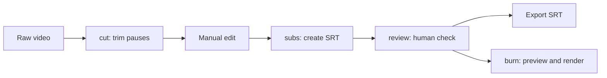

<div align="center">
  
  <h1>shaw-autocut</h1>
  <p><strong>Trim long pauses in talking head videos, review Chinese subtitles, and export SRT or a captioned video.</strong></p>
  <p><a href="./README.md">English</a> · <a href="./README_zh.md">简体中文</a> · <a href="#quick-start">Quick Start</a></p>
  
</div>

> This illustration explains the workflow; it is not a screenshot or a real output comparison. Current version: **0.1.2**.

## Overview

shaw-autocut is a command line video post production tool that can also run as an Agent Skill. It trims silent pauses, then helps you generate Chinese subtitles from a final video you have edited in a video editor. You review the subtitles before exporting SRT or burning them into the video.

> [!IMPORTANT]
> Pause trimming only removes silent sections. Repeated lines, mistakes, and unwanted content still need a manual edit; recognized subtitles also need human review.

## Features

| Feature | Input and result |
| --- | --- |
| Pause trimming | `cut` reads a video and writes `<name>_cut.<original extension>` beside it; `--dry-run` analyzes only. |
| Chinese subtitles | `subs` reads the final edited video and writes a matching `.srt`; `--hotwords` supplies domain terms. |
| Human review | `review --serve` opens a local review page; finish by clicking “审核完成” (Complete review). |
| Preview and burn in | `burn --preview` compares styles on a real frame; `burn` writes `<name>_subtitled.<original extension>`. |
| Agent integration | Each command ends with one JSON line containing fields such as `ok` and `next`. |


*The image is a style illustration with a consistent frame and font size, not speech recognition output. Preview against your own video before burning subtitles.*

## Quick Start

You need **Python 3.9+** and **ffmpeg / ffprobe**. Pause trimming also needs `numpy`. From the project directory:

```bash
python -m pip install -e .
shaw-autocut cut "raw-video.mp4" --dry-run
shaw-autocut cut "raw-video.mp4"
```

`--dry-run` reports the estimated removed duration and number of cuts without creating a video. Without installing the command, run `python scripts/shaw-autocut` with the same arguments from the project directory. If the environment is incomplete, run `shaw-autocut setup` to inspect the plan, then `shaw-autocut setup --yes` after confirming it. In mainland China, `--mirror tuna` is available.

Edit the cut video in your editor, export the final video, then generate and review subtitles:

```bash
shaw-autocut subs "final-video.mp4"
shaw-autocut review "final-video.mp4" --serve
```

The default recognizer is local FunASR; the first subtitle run downloads a model of about 1 GB. Pause trimming does not need that model. Correct the text on the review page and click “审核完成” (Complete review). You can import `final-video.srt` into an editor, or continue:

```bash
shaw-autocut burn "final-video.mp4" --preview
shaw-autocut burn "final-video.mp4" --style box --platform douyin
```

The styles are `clean`, `box`, `yellow`, and `minimal`. Choose one after viewing the preview. Subtitle review must be complete before burning.

## How It Works



Video and subtitle processing takes place locally; the recognition model needs an initial download. Intermediate files go into `<video name>.shaw-autocut/` beside the source video, while deliverables are written beside the source video.

## Configuration

| Option or command | Purpose |
| --- | --- |
| `cut --min-pause 0.8` | For this run, cut pauses longer than 0.8 seconds; default is 0.6 seconds. |
| `subs --hotwords terms.txt` | Provide one domain term per line for recognition. |
| `burn --style box --platform douyin` | Use the box style and Douyin screen clearance for this run. |
| `burn --preview --size-scale 1.2` | Preview subtitles enlarged by 20% on the real frame. |
| `config set silence.min_pause 0.8` | Save a pause threshold for future runs. |

See the [parameter guide](references/parameters.md) and [troubleshooting guide](references/troubleshooting.md).

## Use as an Agent Skill

Put the complete project directory in your Agent's Skills directory, such as `~/.codex/skills/shaw-autocut` for Codex, then ask:

> Use shaw-autocut to remove silent pauses from my talking head video. Report the original length, final length, and number of cuts.

The Agent workflow is documented in [SKILL.md](SKILL.md). You must complete subtitle review in the browser, then choose whether to keep SRT or burn subtitles into the video.

## Contributing

The project is packaged with `pyproject.toml`. For local changes, run:

```bash
python -m pip install -e ".[dev]"
python -m pytest
```

See [UPGRADE.md](UPGRADE.md) for installation and upgrades, and [CHANGELOG.md](CHANGELOG.md) for release notes.

## License

The code is licensed under [MIT](LICENSE). Recognition models and commercial fonts may carry separate licensing terms; check them before publishing.

Image credits: concept art created with shaw-ip-illustrations; [cover prompt](assets/readme/shaw-ip-cover-v1.prompt.md) · [style layout source](assets/readme/subtitle-four-styles-correct-ratio-v1.html).
