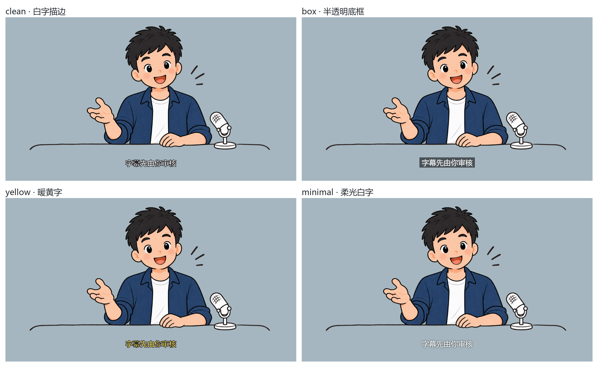
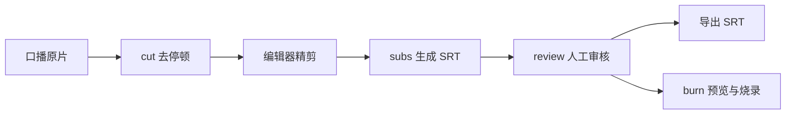

<div align="center">
  
  <h1>shaw-autocut</h1>
  <p><strong>剪掉口播长停顿，审核中文字幕，再导出 SRT 或烧录成片。</strong></p>
  <p><a href="./README.md">English</a> · <a href="./README_zh.md">简体中文</a> · <a href="#快速开始">快速开始</a></p>
  
</div>

> 概念插画用于说明流程，并非软件界面或真实效果对比。当前版本：**0.1.2**。

## 项目简介

shaw-autocut 是一个可交给 Agent 使用的口播视频后期工具，也可直接通过命令行运行。它先剪去无声停顿；你在剪映等编辑器里精剪内容后，再生成中文字幕，人工审核并选择导出 SRT 或烧录视频。

> [!IMPORTANT]
> 去停顿只处理无声片段。重复、口误和多余内容仍需人工精剪；识别出的字幕也必须人工审核。

## 核心特性

| 功能 | 输入与结果 |
| --- | --- |
| 去停顿 | `cut` 读取视频，默认在同目录输出 `<文件名>_cut.<原后缀>`；`--dry-run` 只分析。 |
| 生成字幕 | `subs` 读取精剪后的最终视频，输出同名 `.srt`；可用 `--hotwords` 提供专有名词。 |
| 人工审核 | `review --serve` 打开本地审核页，修改后点击“审核完成”。 |
| 样式预览与烧录 | `burn --preview` 在真实视频画面上比较样式；`burn` 输出 `<文件名>_subtitled.<原后缀>`。 |
| Agent 集成 | 每条命令最后输出一行 JSON，供 Agent 读取 `ok`、`next` 等字段。 |



*图中为统一画面与字号的样式示意，不是语音识别结果。实际烧录前请用自己的视频运行 `--preview`。*

## 快速开始

需要 **Python 3.9+**、**ffmpeg / ffprobe**；去停顿还需要 `numpy`。在项目目录中安装命令行入口：

```bash
python -m pip install -e .
shaw-autocut cut "口播原片.mp4" --dry-run
shaw-autocut cut "口播原片.mp4"
```

`--dry-run` 会报告预计剪去的时长与段数，不输出成片。未安装命令行入口时，可从项目目录运行 `python scripts/shaw-autocut` 加相同参数。若返回环境未就绪，先运行 `shaw-autocut setup` 查看安装计划，确认后再运行 `shaw-autocut setup --yes`；中国大陆可加 `--mirror tuna`。

把去停顿结果放进剪映等编辑器，剪掉重复或多余内容，导出最终视频，然后运行：

```bash
shaw-autocut subs "最终版.mp4"
shaw-autocut review "最终版.mp4" --serve
```

默认识别引擎为本地 FunASR，首次使用字幕识别需要下载约 1 GB 模型；仅去停顿无需该模型。审核页修改完错字后点击“审核完成”。随后可直接将 `最终版.srt` 导入剪映（“文本 → 本地字幕 → 导入”），或继续：

```bash
shaw-autocut burn "最终版.mp4" --preview
shaw-autocut burn "最终版.mp4" --style box --platform douyin
```

四种样式为 `clean`、`box`、`yellow`、`minimal`。先看预览图，再选择适合画面的样式。烧录前必须完成字幕审核。

## 工作原理



视频与字幕在本地处理；识别模型首次使用时需要下载。工作文件写入视频旁的 `<视频名>.shaw-autocut/` 目录，交付文件写在原视频旁。

## 配置

| 参数或命令 | 用途 |
| --- | --- |
| `cut --min-pause 0.8` | 本次只剪超过 0.8 秒的停顿；默认 0.6 秒。 |
| `subs --hotwords terms.txt` | 每行一个专有名词，辅助识别。 |
| `burn --style box --platform douyin` | 本次使用底框样式和抖音画面避让预设。 |
| `burn --preview --size-scale 1.2` | 在真实画面上预览放大 20% 的字幕。 |
| `config set silence.min_pause 0.8` | 保存以后使用的去停顿偏好。 |

更多可选项见[配置说明](references/parameters.md)；环境问题见[常见问题](references/troubleshooting.md)。

## 让 Agent 使用

将整个项目目录放到 Agent 的 Skills 目录，例如 Codex 的 `~/.codex/skills/shaw-autocut`，然后说：

> 用 shaw-autocut 剪掉口播原片里的无声停顿。完成后告诉我原长、剪后时长和剪掉几处。

Agent 的具体执行步骤见 [SKILL.md](SKILL.md)。字幕审核需要你在审核页亲自完成；审核后再选择只要 SRT，还是烧录进视频。

## 参与贡献

项目使用 `pyproject.toml` 管理 Python 包；本地修改后可运行：

```bash
python -m pip install -e ".[dev]"
python -m pytest
```

安装与升级步骤见 [UPGRADE.md](UPGRADE.md)，版本变化见 [CHANGELOG.md](CHANGELOG.md)。

## 许可证

项目代码采用 [MIT 许可证](LICENSE)。识别模型与商用字体可能另有许可要求，请在发布前核对各自条款。

图片来源：使用 shaw-ip-illustrations 制作的概念图；[封面提示词](assets/readme/shaw-ip-cover-v1.prompt.md) · [样式图排版文件](assets/readme/subtitle-four-styles-correct-ratio-v1.html)。
